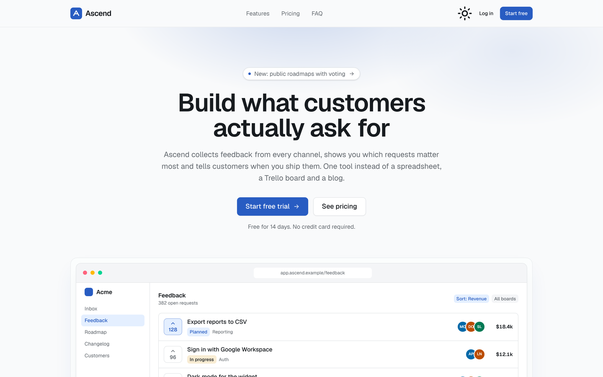
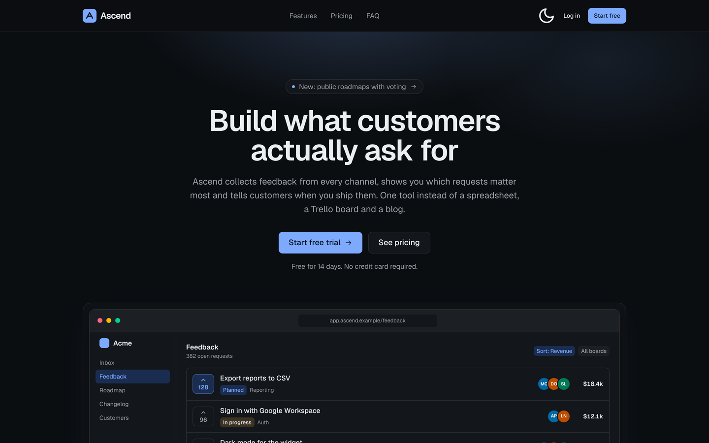

# Ascend Lite — free SaaS landing page for Next.js

A free, MIT-licensed SaaS landing page built with **Next.js 16**, **React 19**, **TypeScript** and **Tailwind CSS 4**. No other dependencies.

Ascend Lite is the free version of [Ascend](https://ascend.bontemplates.com/product). Use it in any project, personal or commercial.



## What's inside

- A complete home page: hero with a product mockup, logo cloud, feature grid, three feature showcases, how it works, stats, testimonials, pricing with a monthly / yearly toggle, FAQ and a call to action
- Sticky header with a mobile menu (native popover, no menu library)
- Footer with a working newsletter form (server action with validation, ready for your email provider)
- Dark mode with no flash on load
- Product screenshots drawn in HTML and CSS: sharp at any size, and they follow dark mode and your brand color
- Rebrand by changing one CSS variable (`--brand` in `src/app/globals.css`)
- SEO basics: metadata, Open Graph image, sitemap and robots
- WCAG AA contrast in light and dark mode (checked with axe), skip link, keyboard friendly



## Getting started

[](https://vercel.com/new/clone?repository-url=https://github.com/bonnv79/ascend-lite)

Or run it locally:

```bash
npm install
npm run dev
```

Open http://localhost:3000.

## Customizing

- **Text:** all copy lives in `src/content/home.tsx` and `src/content/pricing.ts`. You don't need to touch the components to change the words.
- **Name, links, navigation:** `src/config/site.ts`. Set `signupUrl` and `loginUrl` to your app, and `NEXT_PUBLIC_SITE_URL` to your domain when you deploy (on Vercel the production URL is used until you do).
- **Colors:** the CSS variables in `src/app/globals.css` (light mode in `:root`, dark mode in `.dark`).
- **Newsletter:** add your provider (Resend, Loops, ConvertKit...) at the `TODO` in `src/app/actions.ts`.
- **Screenshots:** the mockups are in `src/components/mockups`. Edit the data arrays at the top, or replace `<AppMockup />` with `next/image` when you have real screenshots.
- **Upgrade links:** the footer has an "Ascend Pro" group. Delete it in `src/config/site.ts` to remove it.

## Lite vs Pro

| | Lite (free) | [Pro](https://ascend.bontemplates.com/product) |
| --- | --- | --- |
| Home page with all sections | ✓ | ✓ |
| Dark mode, responsive, SEO basics | ✓ | ✓ |
| Pricing page with comparison table and pricing FAQ | | ✓ |
| Blog with featured post, article pages, RSS feed and JSON-LD | | ✓ |
| Changelog with New / Improved / Fixed labels | | ✓ |
| About and Contact pages (contact form with server action) | | ✓ |
| Log in, Sign up, Terms, Privacy | | ✓ |
| Bon UI components (Button, Accordion, Drawer, Toast...) | | ✓ |
| Email support | | ✓ |

See every Pro page in the [live demo](https://ascend.bontemplates.com).

## License

MIT, see [LICENSE](LICENSE). Third-party packages keep their own licenses (Next.js, React, Tailwind CSS: MIT; Geist font: OFL 1.1).

Names, companies, quotes and numbers on the page are fictional.

## More templates

- [Pulse](https://pulse.bontemplates.com/product): a SaaS analytics dashboard. Its free version is [Pulse Lite](https://github.com/bonnv79/pulse-lite).
- [Tandem](https://crm.bontemplates.com/product): a CRM dashboard with a drag-and-drop pipeline.
- [Bon UI](https://ui.bontemplates.com): 30+ accessible React components for Tailwind CSS 4.

All at [bontemplates.com](https://www.bontemplates.com).
